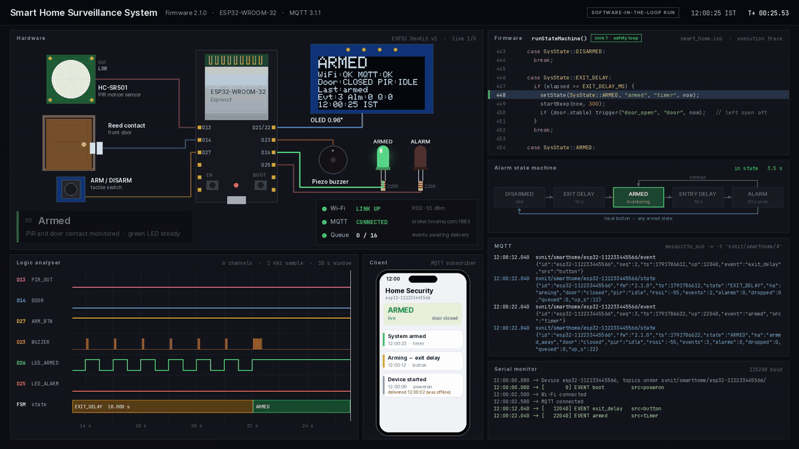
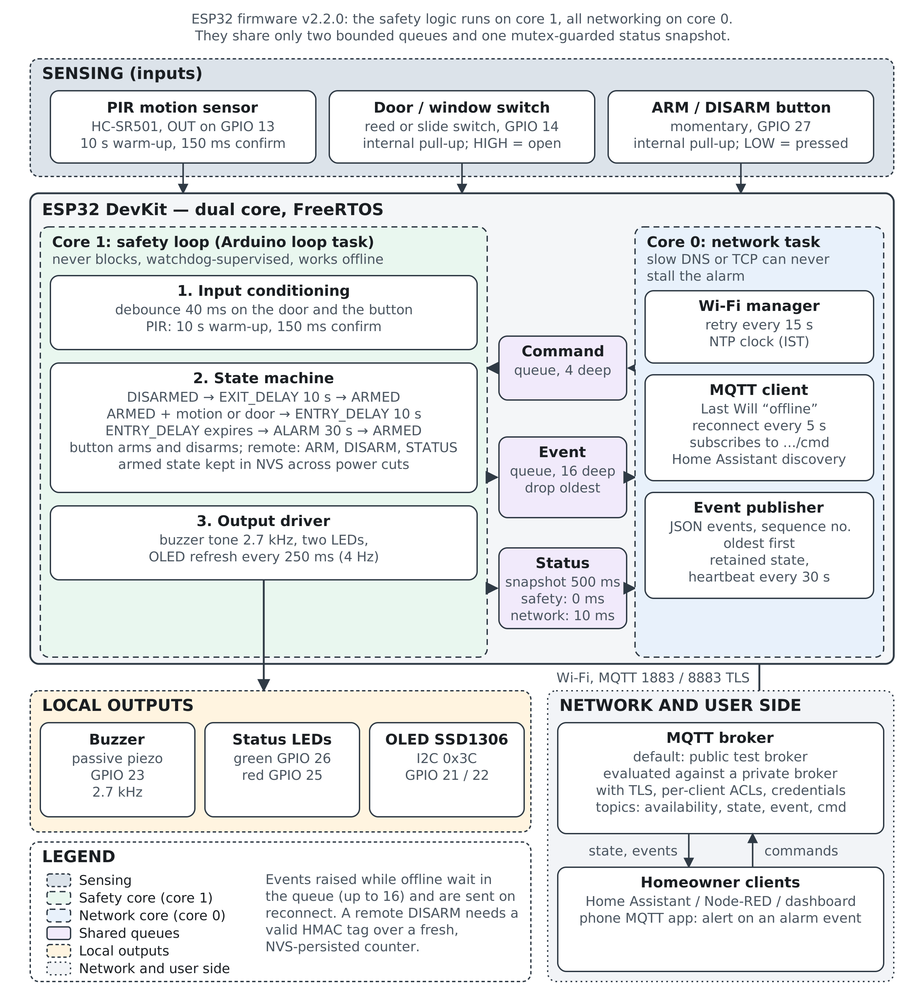
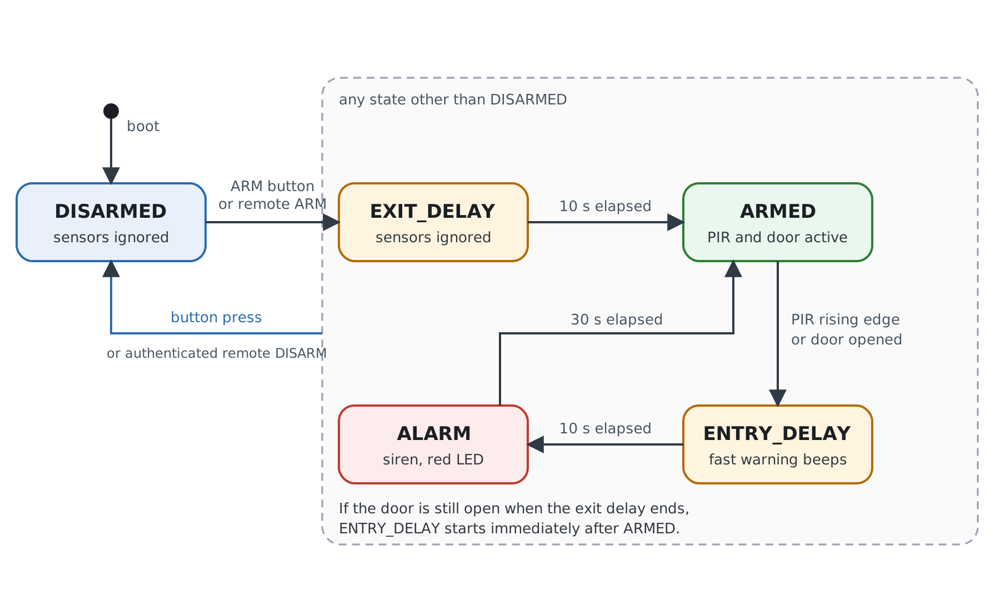
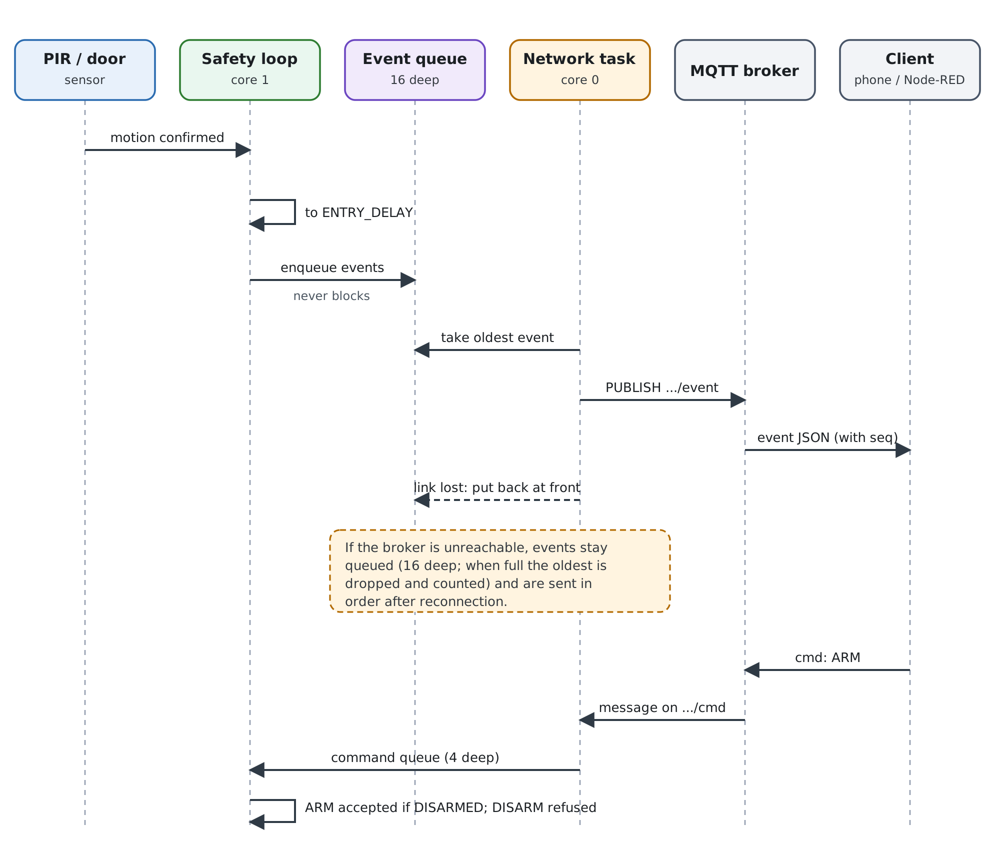
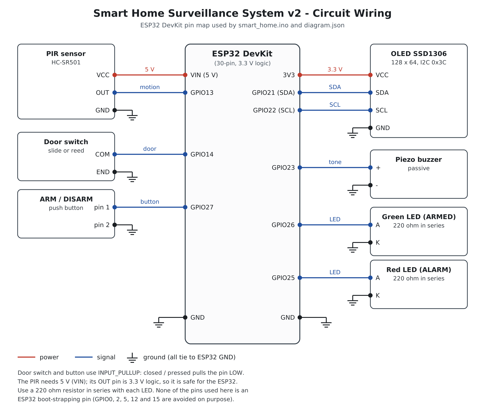
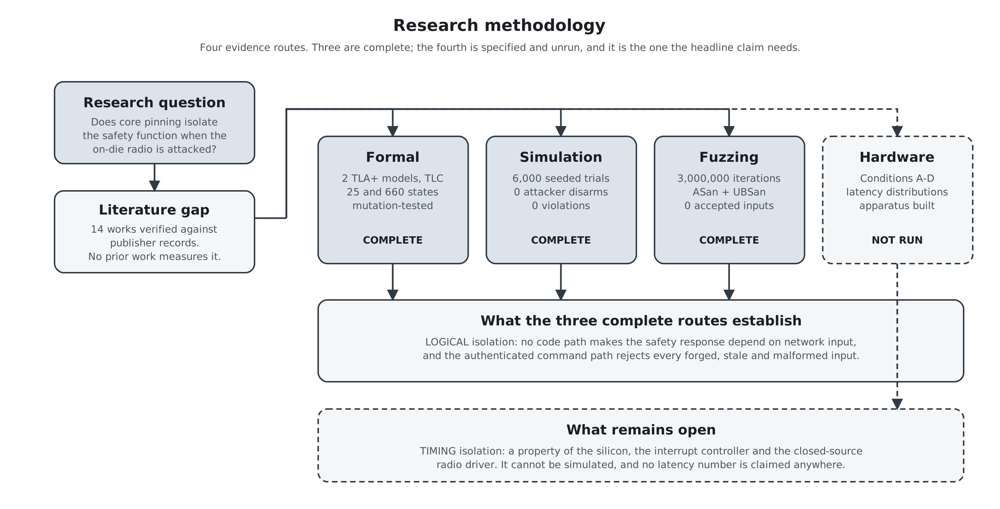

# Smart Home Surveillance System

[](https://github.com/mdhumayun7/Smart-Home-Automation/actions/workflows/ci.yml)


[](LICENSE)

ESP32 intrusion alarm firmware with a PIR motion sensor, a door contact, a local siren and status display, MQTT alerts and Home Assistant integration, hardened against network and radio attacks and verified formally.

Its main design rule is that the alarm never depends on the network. The detection logic and the siren run on one core and never wait for anything. Wi-Fi, NTP and MQTT run in a separate FreeRTOS task on the other core and exchange data with the alarm logic only through bounded queues.



*Software-in-the-loop run of the firmware: logic analyser view of the GPIO lines, live source trace, the display and MQTT traffic. [Full 2-minute video](docs/media/smart_home_demo.mp4).*

---

## Contents

- [Features](#features)
- [Architecture](#architecture)
- [Hardware](#hardware)
- [Getting started](#getting-started)
- [Configuration](#configuration)
- [MQTT interface](#mqtt-interface)
- [Home Assistant](#home-assistant)
- [Security and attack resistance](#security-and-attack-resistance)
- [Formal verification](#formal-verification)
- [Research](#research)
- [Reliability and safety](#reliability-and-safety)
- [Testing and CI](#testing-and-ci)
- [Project structure](#project-structure)
- [Roadmap](#roadmap)

## Features

**Alarm logic**
- Five-state machine: `DISARMED`, `EXIT_DELAY` (10 s), `ARMED`, `ENTRY_DELAY` (10 s), `ALARM` (30 s, then re-arms)
- PIR filtering: warm-up period, 150 ms confirmation and rising-edge trigger, so one person standing still does not retrigger the alarm
- Door contact and ARM/DISARM button with 40 ms debouncing
- Buzzer (2.7 kHz tone), two status LEDs and an SSD1306 OLED status screen

**Reliability**
- No blocking calls in the safety loop; all timing is wrap-safe across the 49.7-day `millis()` overflow
- Armed state stored in NVS and restored after a power cut, so cutting the supply does not disarm the house
- Task watchdog on the safety loop; the boot event reports the reset reason
- Offline event queue (16 events) delivered in order after reconnecting; losses are counted, never silent

**Connectivity**
- MQTT with Last Will, retained state, 30 s heartbeat and one JSON message per event with a sequence number
- Credentials in a git-ignored `secrets.h`; optional TLS on port 8883
- Home Assistant MQTT discovery as an alarm control panel

**Security and attack resistance** (see [threat model](docs/THREAT_MODEL.md))
- Authenticated commands: HMAC-SHA256 tag over a strictly increasing, NVS-persisted counter; forged and replayed commands are rejected
- Wi-Fi deauthentication-flood detection and a `link_lost` alert when the link drops while armed
- ESP-NOW fallback channel: signed alerts to a second ESP32 when MQTT is unreachable
- PIR + mmWave radar fusion to cut false alarms
- State machine and command path proved correct in TLA+

## Architecture



| Core | Task | Responsibility |
|---|---|---|
| 1 | Arduino `loop` (safety loop) | Input conditioning, state machine, buzzer, LEDs, display. Never calls the network. |
| 0 | `net` task | Wi-Fi with retry, NTP, MQTT connection, event delivery, heartbeat, Home Assistant discovery. |

The two tasks share two FreeRTOS queues (events from core 1 to core 0, commands from core 0 to core 1) and one status snapshot that is protected by a mutex. The safety loop never waits on the mutex; it skips a snapshot rather than block.

<details>
<summary>State machine</summary>



If the door is still open when the exit delay ends, the entry delay starts immediately. Only the local button can disarm the system by default.
</details>

<details>
<summary>Event delivery and command flow</summary>



The network task removes an event from the queue before publishing it. If the link drops during the publish, the event goes back to the front of the queue, so the order is kept and nothing is lost silently.
</details>

## Hardware



| GPIO | Part | Notes |
|---|---|---|
| 13 | HC-SR501 PIR, OUT | Powered from VIN (5 V); OUT is 3.3 V logic |
| 14 | Door contact (reed or slide switch) | `INPUT_PULLUP`; HIGH = open |
| 27 | ARM/DISARM push button | `INPUT_PULLUP`; LOW = pressed |
| 23 | Piezo buzzer | 2.7 kHz tone from the LEDC peripheral; `BUZZER_ACTIVE 1` for an active buzzer |
| 26 | Green LED (armed) | 220 ohm series resistor |
| 25 | Red LED (alarm) | 220 ohm series resistor |
| 21 / 22 | SSD1306 OLED, SDA / SCL | I2C address 0x3C |

None of the ESP32 strapping pins (GPIO 0, 2, 5, 12, 15) is used.

**Bill of materials:** ESP32 DevKit v1, HC-SR501 PIR module, reed switch, tactile push button, passive piezo buzzer, green and red 5 mm LEDs with two 220 ohm resistors, 0.96" SSD1306 OLED (I2C).

**Build size** (from CI, `esp32:esp32:esp32`):

| arduino-esp32 | Flash | RAM (globals) |
|---|---|---|
| 2.0.17 | 793,433 B (60.5 % of 1,310,720) | 46,372 B (14.2 % of 327,680) |
| 3.3.12 | 968,221 B (73.9 % of 1,310,720) | 49,876 B (15.2 % of 327,680) |

The v2.2 security features (HMAC command authentication, the deauth detector, sensor fusion and the signed-alert format) add roughly 3 KB of flash and 170 bytes of RAM over v2.1.

## Getting started

### In the Wokwi simulator

1. Create an ESP32 project at [wokwi.com](https://wokwi.com).
2. Copy `firmware/smart_home/smart_home.ino` into `sketch.ino`, and replace `diagram.json` and `libraries.txt` with the files in `wokwi/`.
3. Start the simulation. Press the ARM button, wait for `ARMED`, then click the PIR sensor or toggle the door switch.

The default build uses the simulator's `Wokwi-GUEST` network and the public HiveMQ broker, so no configuration is needed.

### On an ESP32 board

1. Install the ESP32 board package (arduino-esp32 2.0.17 or 3.x) and the libraries **Adafruit SSD1306**, **Adafruit GFX Library** and **PubSubClient**.
2. Copy `firmware/smart_home/secrets.example.h` to `firmware/smart_home/secrets.h` and fill in your Wi-Fi and broker details.
3. Set `PIR_WARMUP_MS` to `60000` for a physical HC-SR501, which needs about a minute to settle.
4. Select **ESP32 Dev Module** and upload. The Serial Monitor (115200 baud) prints the device id and the MQTT topics.

With `arduino-cli`:

```bash
arduino-cli compile --fqbn esp32:esp32:esp32 firmware/smart_home
arduino-cli upload  --fqbn esp32:esp32:esp32 -p /dev/ttyUSB0 firmware/smart_home
```

## Configuration

| Setting | Where | Default |
|---|---|---|
| Wi-Fi SSID, password, channel | `secrets.h` | `Wokwi-GUEST`, open, channel 6 |
| Broker host, port, user, password | `secrets.h` | `broker.hivemq.com:1883`, no login |
| TLS and CA certificate | `secrets.h` (`MQTT_USE_TLS`, `SECRET_MQTT_CA_CERT`) | Off |
| Remote DISARM | `secrets.h` (`ALLOW_REMOTE_DISARM`) | Off; requires TLS and login |
| Exit / entry delay, alarm duration | `smart_home.ino` | 10 s / 10 s / 30 s |
| PIR warm-up and confirmation | `smart_home.ino` | 10 s / 150 ms |
| Home Assistant discovery | `HA_DISCOVERY` | On |
| Restore armed state at boot | `RESTORE_ARMED_ON_BOOT` | On |
| Loop watchdog | `ENABLE_LOOP_WDT` | On |

## MQTT interface

All topics are under `svnit/smarthome/<deviceId>/`, where the device id is derived from the chip's MAC address (for example `esp32-A1B2C3D4E5F6`).

| Topic | Direction | Retained | Content |
|---|---|---|---|
| `availability` | device to broker | yes | `online`, or `offline` as the Last Will |
| `state` | device to broker | yes | JSON snapshot on every change and every 30 s |
| `event` | device to broker | no | One JSON message per event |
| `cmd` | broker to device | no | `ARM` (or `ARM_AWAY`), `STATUS`; `DISARM` only if enabled |

```json
{"id":"esp32-A1B2C3D4E5F6","seq":7,"ts":1791786626,"up":26150,"event":"motion","src":"pir"}
```

```json
{"id":"esp32-A1B2C3D4E5F6","fw":"2.1.0","ts":1791786660,"state":"ALARM","ha":"triggered","door":"closed",
 "pir":"idle","rssi":-55,"events":12,"alarms":1,"dropped":0,"queued":0,"up_s":60}
```

Events: `boot` (source = reset reason), `restored_armed`, `exit_delay`, `armed`, `motion`, `door_open`, `door_closed`, `entry_delay`, `alarm`, `alarm_end`, `disarmed`, `cmd_rejected`, `cmd_ignored`, and the v2.2 security events `cmd_badmac`, `cmd_replay`, `cmd_unauth`, `wifi_deauth`, `link_lost`.

Signed commands (when authentication is enabled) take the form `<CMD>:<counter>:<hex-tag>`, for example `DISARM:1001:5f3c...`. Sign them with `tools/sign_command.py`. See the [hardening guide](docs/HARDENING.md).

`ts` is UTC epoch seconds once NTP has synchronised (0 before), `up` is milliseconds since boot, and `seq` increases by one per event since boot, so a client can detect missing or duplicate messages.

Watch the demo device with:

```bash
mosquitto_sub -h broker.hivemq.com -t "svnit/smarthome/#" -v
```

## Home Assistant

With the MQTT integration enabled, the device publishes a retained discovery message to `homeassistant/alarm_control_panel/<deviceId>/config` and appears as an alarm panel named **Smart Home Surveillance**. The firmware states map to Home Assistant states as follows:

| Firmware | Home Assistant |
|---|---|
| `DISARMED` | `disarmed` |
| `EXIT_DELAY` | `arming` |
| `ARMED` | `armed_away` |
| `ENTRY_DELAY` | `pending` |
| `ALARM` | `triggered` |

Arming from Home Assistant works out of the box. Disarming from Home Assistant is rejected unless command authentication, or remote disarm with TLS and a broker login, has been enabled.

## Security and attack resistance

A networked alarm is also a target. The [threat model](docs/THREAT_MODEL.md) sets out the
adversaries and the full list of threats and mitigations; the highlights:

| Attack | Defence |
|---|---|
| Forged `DISARM` command | HMAC-SHA256 tag over the command; a bad tag is rejected (`cmd_badmac`) |
| Replay of a captured signed command | Strictly increasing counter, persisted in NVS (`cmd_replay`); survives reboots |
| Deauthentication flood to drop the link | Passive flood detection (`wifi_deauth`); the alarm keeps working offline |
| Knocking the device offline silently | `link_lost` event while armed; broker Last Will; ESP-NOW fallback alert |
| Cutting mains power while armed | Armed state restored from NVS; a door open at power-up re-triggers |
| Fake alerts to cause alarm fatigue | ESP-NOW alerts are HMAC-authenticated and counter-checked |
| PIR false triggers | Optional PIR + mmWave radar fusion (AND mode) |

The command and alert authentication is the portable HMAC-SHA256 in
`firmware/smart_home/authmac.h`, unit-tested against RFC 4231 and FIPS 180-4 vectors and
cross-checked between `tools/sign_command.py` and the firmware. Deployment steps (TLS, private
broker, keys, ESP-NOW, flash encryption) are in the [hardening guide](docs/HARDENING.md), and
the measured and to-be-measured results are in the [evaluation](docs/EVALUATION.md).

## Formal verification

The alarm state machine and the authenticated-command path are modelled in TLA+
([`formal/AlarmFSM.tla`](formal/AlarmFSM.tla)) and model-checked by TLC over the whole state
space (a CI job and `./formal/run_tlc.sh`). The proof establishes, for every reachable state:

- an unauthenticated remote command never disarms the system;
- the replay counter never decreases;
- the siren is never active while disarmed;
- the entry delay and the alarm always resolve (no stuck state).

The spec is mutation-tested, so the properties are known not to be vacuous.

## Research

### Abstract

Consumer intrusion alarms are built almost entirely on single-chip Wi-Fi SoCs, where the Wi-Fi
driver, the TCP/IP stack, the MQTT client and the safety application all execute on one die,
under one RTOS scheduler, sharing one interrupt controller. The standard engineering mitigation
is to pin the safety task to its own core. That advice comes from a literature studying
Linux-class and hypervisor-capable platforms, in which the attacked network interface is
physically separate from the protected core. This work asks whether it still holds when the
attacked resource is the chip's own radio driver. We specify the isolation argument itself in
TLA+ and check it exhaustively with TLC under a network task given no fairness assumption; we
harden the device with HMAC-SHA256 command authentication over a reboot-persistent replay
counter, passive deauthentication detection and a signed out-of-band fallback channel; and we
evaluate it with a 6,000-trial seeded adversarial campaign and 3,000,000 sanitizer-backed fuzz
iterations. These establish *logical* isolation. *Timing* isolation is a property of the silicon
and the closed-source radio driver, cannot be simulated, and is specified here as the open step:
no latency figure is claimed anywhere in this work.

### Problem statement and motivation

A domestic alarm is a safety-critical system that people buy for £30 and never think about
again. If its siren can be delayed or suppressed by an attacker standing outside the house with
a £5 board, the device fails at the only job it has. Deauthentication attacks against this
hardware class are cheap, portable and already demonstrated in the literature on this exact chip
family. What has not been established is whether the resulting radio-stack load reaches the
safety function.

### Research gap

Verified against fourteen prior works in [`docs/RELATED_WORK.md`](docs/RELATED_WORK.md):

- **Timing isolation under attack** is established, but only on platforms that can separate the
  attacked interface from the protected core — Linux-class industrial boards, x86 with PREEMPT-RT
  and dedicated NIC queues, Cortex-A53 with a hypervisor and an FPGA memory scheduler. None of
  those mechanisms exist on a 240 MHz MCU.
- **Deauthentication resilience** has been quantified, but the dependent variable is always
  whether the *link* drops, never whether the device's *application* meets its deadline.
- **ESP32 security work** measures transport cost or detection accuracy, not safety continuity.

No published work measures a safety deadline on a device whose own radio driver is the attacked
resource.

### Objectives and contributions

1. An open, hardened dual-core alarm firmware with authenticated commands, replay protection,
   passive deauth detection, a signed out-of-band fallback and optional sensor fusion.
2. Two TLA+ specifications checked exhaustively by TLC, the second formalising the
   safety/network **isolation argument** under an unfair, maximally adversarial network task.
   Both mutation-tested, so the verified properties are demonstrably non-vacuous.
3. A seeded, reproducible adversarial campaign and a sanitizer-backed fuzzing campaign.
4. A measurement protocol and instrumentation for the one claim that requires silicon, stated
   openly as the open step rather than estimated.

### Methodology



*Four independent evidence routes. Three are complete and together establish logical isolation;
the fourth is specified and unrun.* Full figure index: [`docs/FIGURES.md`](docs/FIGURES.md).

### Evaluation metrics

| Metric | Definition | Where |
|---|---|---|
| Safety latency | Trigger to siren assertion, ms | Campaign; hardware protocol |
| Attacker state change | Trials in which an unauthenticated command armed or disarmed | Campaign |
| Command availability | Trials in which the legitimate command took effect | Campaign |
| Invariant violations | Trials violating any safety invariant | Campaign |
| Accepted fuzz inputs | Inputs changing state or advancing the counter without a valid tag | Fuzzer |
| State-space coverage | Distinct states explored exhaustively | TLC |

### Results and baseline comparison

| Metric | Baseline (no auth) | Hardened (`AUTH_COMMANDS=1`) |
|---|---|---|
| Attacker armed the system, flooded trials | 2,500 / 2,500 | **0 / 2,500** |
| Legitimate command took effect, all trials | 500 / 3,000 | **3,000 / 3,000** |
| Attacker-caused disarms | 0 | 0 |
| Safety-invariant violations | 0 | 0 |
| Safety latency, median | 151 ms | 151 ms |

Fuzzing: 3,000,000 iterations, 0 memory errors, 0 accepted inputs. Formal: AlarmFSM 25 distinct
states, Isolation 660 distinct states at depth 26, all properties hold, both mutation-tested.
Build cost of the v2.2 security features: ≈3 KB flash, ≈170 B RAM.

**Read the results honestly.** The security outcome follows deductively from the construction;
the campaign validates that the implementation matches the design. The informative result is the
availability one, which does not follow from the cryptography. Because the harness advances a
logical clock, latency variance is identically zero, so no hypothesis test is reported on these
data — the analysis is pre-registered for the hardware measurements instead.

### Limitations and future work

No hardware measurement has been performed; every result is formal or simulated. Claims are
scoped to the dual-core Xtensa ESP32 under arduino-esp32 2.0.17 and 3.3.12 and are not
generalised to single-chip Wi-Fi SoCs as a class. There is no energy measurement and no
deployment data. Flash encryption, secure boot and signed OTA are not implemented, which means
the command key is recoverable from a flash dump and the signed-command guarantee is scoped
accordingly. The ablation models broker admission as a boolean, so a broker enforcing per-client
topic ACLs is not represented. A full, adversarial account is in
[`docs/PEER_REVIEW.md`](docs/PEER_REVIEW.md).

### Data and code availability

All data are generated deterministically from fixed seeds by scripts in this repository.
Aggregate results are committed; per-trial records regenerate identically via
`experiments/run.sh`, verified byte-identical. No third-party or human-subject data are used.
Everything is MIT-licensed.

### Citation

See [`CITATION.cff`](CITATION.cff), or use GitHub's "Cite this repository" button.

---

This repository doubles as the reproducible artifact for a study of a research question:
*on a single-chip Wi-Fi SoC, does pinning the safety function to the application core actually
isolate it from attacks on the device's own radio and command interface?* The design, the gap
in the 2025-26 literature, the claims and the evidence are written up in
[`docs/RESEARCH.md`](docs/RESEARCH.md), with a paper draft in [`paper/`](paper/) and all
experiments in [`experiments/`](experiments/). A surveyed and verified positioning against
fourteen prior works is in [`docs/RELATED_WORK.md`](docs/RELATED_WORK.md).

Evidence produced here (all reproducible from fixed seeds):

- **Formal.** Two TLA+ models, checked exhaustively by TLC and mutation-tested: the state
  machine/command path (25 states) and safety/network isolation under a maximally adversarial,
  unfair network task (660 states).
- **Adversarial campaign.** 6,000 seeded trials injecting forged, replayed and malformed
  commands at up to 20,000 msg/s. No attacker ever disarmed the device and no safety invariant
  was violated; with authentication a legitimate command always took effect, while the
  unhardened baseline was attacker-armed in every flooded trial.
- **Fuzzing.** 3,000,000 iterations of the command parser under AddressSanitizer/UBSan with no
  memory error and no accepted input.
- **Open step.** The one claim that needs silicon -- physical sensor-to-siren latency under
  on-chip radio stress -- has its measurement apparatus and protocol in
  [`experiments/hardware/`](experiments/hardware/) and is stated as future work, not asserted.

Run it all with `experiments/run.sh` and `formal/run_tlc.sh`; a reduced version runs in CI.

### Documentation map

| Document | What it covers |
|---|---|
| [`docs/IMPLEMENTATION.md`](docs/IMPLEMENTATION.md) | **The complete technical record**: architecture, algorithms and mathematical formulations, every configuration parameter, the environment, experimental design, all results, version-by-version comparisons, debugging fixes, validation performed, and every limitation and gap |
| [`docs/RESEARCH.md`](docs/RESEARCH.md) | Research question, hypotheses and claims |
| [`docs/RELATED_WORK.md`](docs/RELATED_WORK.md) | Verified survey of fourteen prior works and the positioning |
| [`docs/THREAT_MODEL.md`](docs/THREAT_MODEL.md) | Assets, adversaries, twelve threats and their mitigations |
| [`docs/EVALUATION.md`](docs/EVALUATION.md) | Evaluation method, results, and the hardware procedure still to run |
| [`docs/ARCHITECTURE.md`](docs/ARCHITECTURE.md) | Traceability matrix, component and deployment architecture, the full state-machine transition table, the event lifecycle and its delivery guarantee, and the command execution model |
| [`docs/HARDENING.md`](docs/HARDENING.md) | Turning the demo build into a deployable system |
| [`docs/FIGURES.md`](docs/FIGURES.md) | Figure index, academic captions and the conventions every figure follows |
| [`docs/PEER_REVIEW.md`](docs/PEER_REVIEW.md) | Adversarial internal review, threats to validity, desk-reject risks and the action plan |
| [`docs/JOURNAL_TARGETS.md`](docs/JOURNAL_TARGETS.md) | Six candidate journals verified against publisher sources, with the Scopus-vs-JCR quartile distinction spelled out |
| [`docs/SUBMISSION.md`](docs/SUBMISSION.md) | Publication ethics, submission inventory, cover letter, highlights and the final QA checklist |
| [`docs/LITERATURE_LOG.md`](docs/LITERATURE_LOG.md) | Dated search log: databases, search strings, screening decisions, and the competing work that narrowed this project's claim |
| [`docs/EXPERIMENTS.md`](docs/EXPERIMENTS.md) | Every result classified by evidence category, with seeds, runs, environment and reproduction commands, plus the seven experiments not yet run |
| [`docs/Q2_GATE.md`](docs/Q2_GATE.md) | Fifteen-question reviewer gate, figure justification, and the IEEE ESL compliance checklist |
| [`REPRODUCTION.md`](REPRODUCTION.md) | **Start here to reproduce anything.** Three evidence levels, software reproduction in about an hour, and a complete independent hardware-validation guide with bill of materials, wiring, conditions, scripts, troubleshooting and falsification criteria |
| [`docs/TIMING_ANALYSIS.md`](docs/TIMING_ANALYSIS.md) | Response-time decomposition of the safety loop: which interference terms the design eliminates by construction, which are irreducibly hardware, and the defect this analysis exposed |
| [`docs/PUBLICATION_READINESS.md`](docs/PUBLICATION_READINESS.md) | Final readiness verdict, re-scored reviewer gate, venue evidence, and likely reviewer objections with answers |
| [`docs/MANUSCRIPT_REVIEW.md`](docs/MANUSCRIPT_REVIEW.md) | Section-by-section verification report, fact-verification record, and the two hardware-scenario pathways with a validation checklist |
| [`paper/manuscript.tex`](paper/) | **Full-length manuscript** (23 pages). `paper/paper.tex` is the short letters-format version |

**Status in one line:** firmware, formal verification, response-time analysis, simulation
campaign, the six-design ablation, sensitivity sweep, fuzzing and the full-length manuscript are
complete and reproducible. The physical timing measurement has **not been performed by anyone**; a complete
framework for an independent laboratory to perform it is in [`REPRODUCTION.md`](REPRODUCTION.md),
and no latency figure is claimed anywhere.

## Reliability and safety

| Concern | How it is handled |
|---|---|
| Slow or failed network calls | Run only on core 0; the safety loop never waits for them |
| `millis()` overflow after 49.7 days | All timing uses unsigned differences or signed deadline comparisons; tests start the clock just before the wrap |
| Power cut while armed | Armed state in NVS, written once per arm and once per disarm |
| Firmware hang | Task watchdog on the loop task; reset reason reported at boot |
| Network outage | 16-event queue, delivered in order; overflow drops the oldest and counts it |
| Faulty display | Initialisation failure is logged and the alarm keeps running |
| Sensor noise | Debouncing, PIR warm-up, confirmation time and edge detection |

See [SECURITY.md](SECURITY.md) for the threat model and the known gaps.

## Testing and CI

```bash
./tests/host/run_tests.sh
```

The firmware source is compiled unchanged on a PC against stub implementations of the Arduino, FreeRTOS, Wi-Fi, MQTT, NVS and display interfaces, with `-Wall -Wextra -Werror`. Nineteen scenarios are each run at three starting values of the millisecond clock (0, 2^31 and just before the 32-bit wrap) and against the arduino-esp32 2.x and 3.x interfaces: 114 runs, plus four build-configuration checks and two shared-header-sync checks. Every MQTT payload is parsed as JSON. The security logic (HMAC commands, replay counter, deauth detector, ESP-NOW alerts, sensor fusion) has its own scenarios, and the cryptography is checked against RFC 4231 / FIPS 180-4 vectors.

| Area | Scenarios |
|---|---|
| State machine | `basic`, `arm_alarm`, `disarm_in_entry`, `door_left_open` |
| Input filtering | `pir_edge`, `pir_glitch` |
| Commands | `remote` |
| Fault tolerance | `display_fail`, `persist`, `restore`, `restore_door`, `diag` |
| Display | `oled` |
| Networking | `network` (retry timing, Last Will, retained state, discovery, ordering, failed publish, queue race, overflow, heartbeat) |
| Security (v2.2) | `auth` (HMAC, replay, counter floor), `wifiguard` (deauth detector), `linklost`, `alert` (ESP-NOW message), `fusion` (PIR + radar) |

GitHub Actions runs the host tests, compiles the firmware and the ESP-NOW receiver for the ESP32 with arduino-esp32 2.0.17 and 3.3.12 (reporting flash and RAM usage), builds the optional-feature configuration, and runs the TLA+ model checker on every push.

What the tests do not cover: electrical behaviour, real Wi-Fi and broker timing, and true parallel execution on the two cores. These need the Wokwi simulator or real hardware.

## Project structure

```
firmware/smart_home/
  smart_home.ino          firmware
  authmac.h               portable SHA-256 / HMAC-SHA256 for signed commands and alerts
  wifi_guard.h            deauth-flood detector logic
  sensor_fusion.h         PIR + mmWave radar fusion logic
  alertmsg.h              signed ESP-NOW alert format
  secrets.example.h       template for credentials and keys (copy to secrets.h)
firmware/espnow_receiver/ second-ESP32 ESP-NOW alert receiver sketch
formal/                   TLA+ model of the state machine and TLC runner
tools/                    command signer and hardware evaluation / measurement scripts
wokwi/                    Wokwi circuit (diagram.json) and library list
tests/host/               host test harness, stubs and run_tests.sh
docs/                     threat model, evaluation, hardening guide, diagrams, demo media
.github/workflows/ci.yml  host tests, ESP32 builds and TLA+ verification
```

## Roadmap

- Signed over-the-air updates, secure boot and flash encryption
- Tamper switch and battery backup with low-battery events
- ESP32-CAM node that captures an image on the `alarm` event
- Hardware measurement campaign (see [evaluation](docs/EVALUATION.md))
- MQTT client with acknowledged delivery (QoS 1) for events

## Author

**MD Humayun**, M.Tech Computer Science and Engineering, SVNIT Surat. [GitHub](https://github.com/mdhumayun7) · [LinkedIn](https://www.linkedin.com/in/md-humayun-82051521a/)

Released under the [MIT License](LICENSE).
