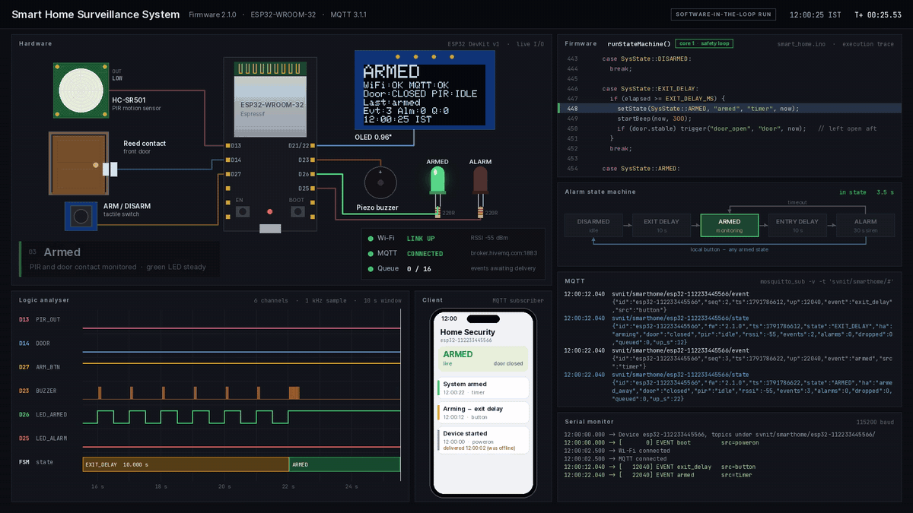
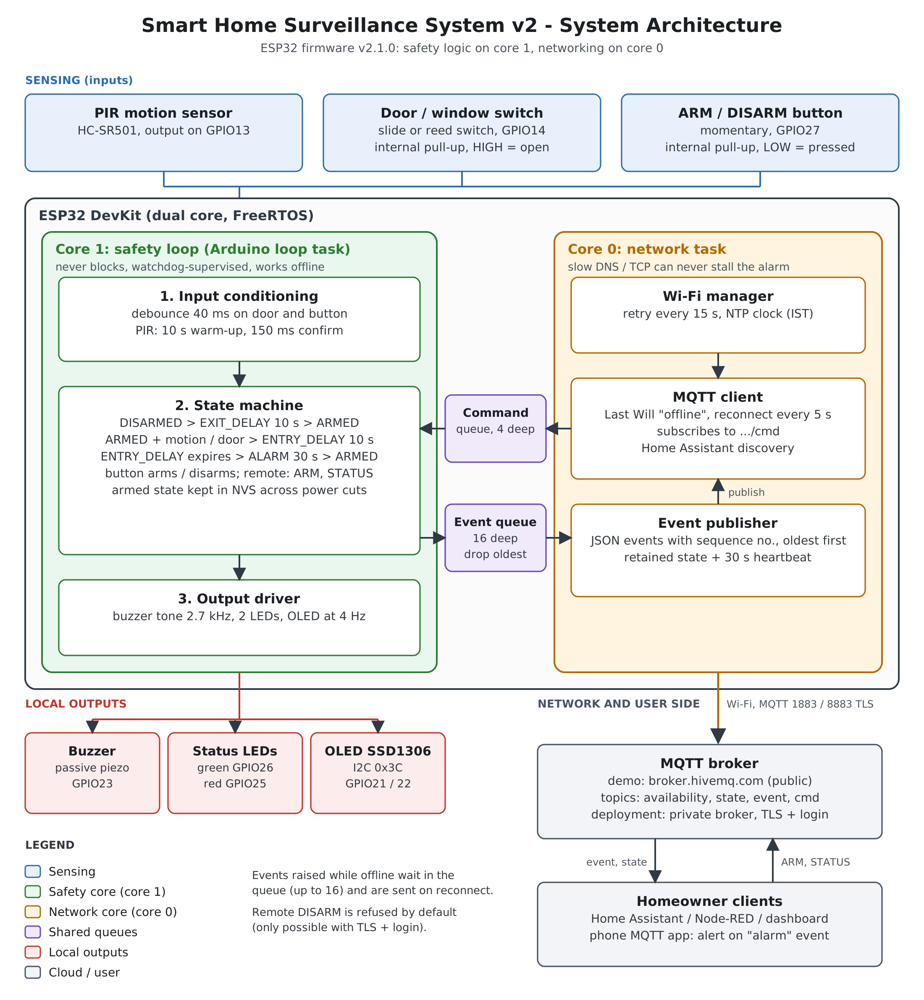
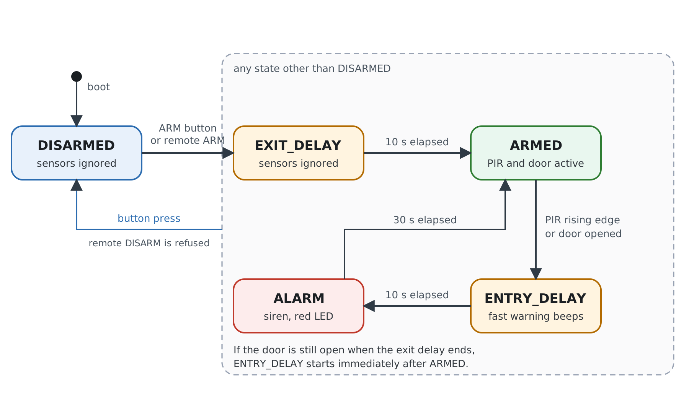
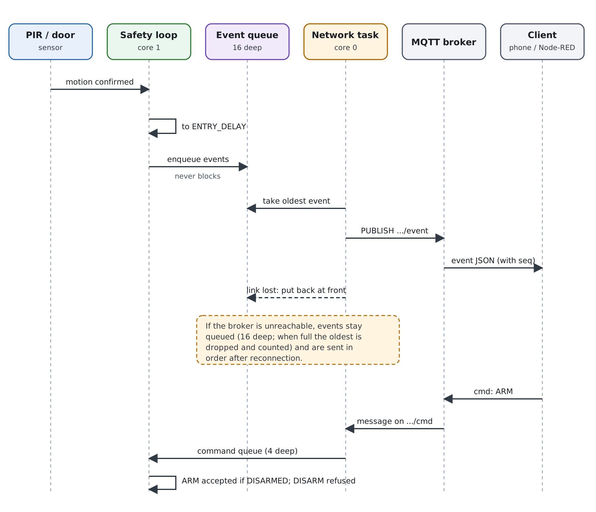
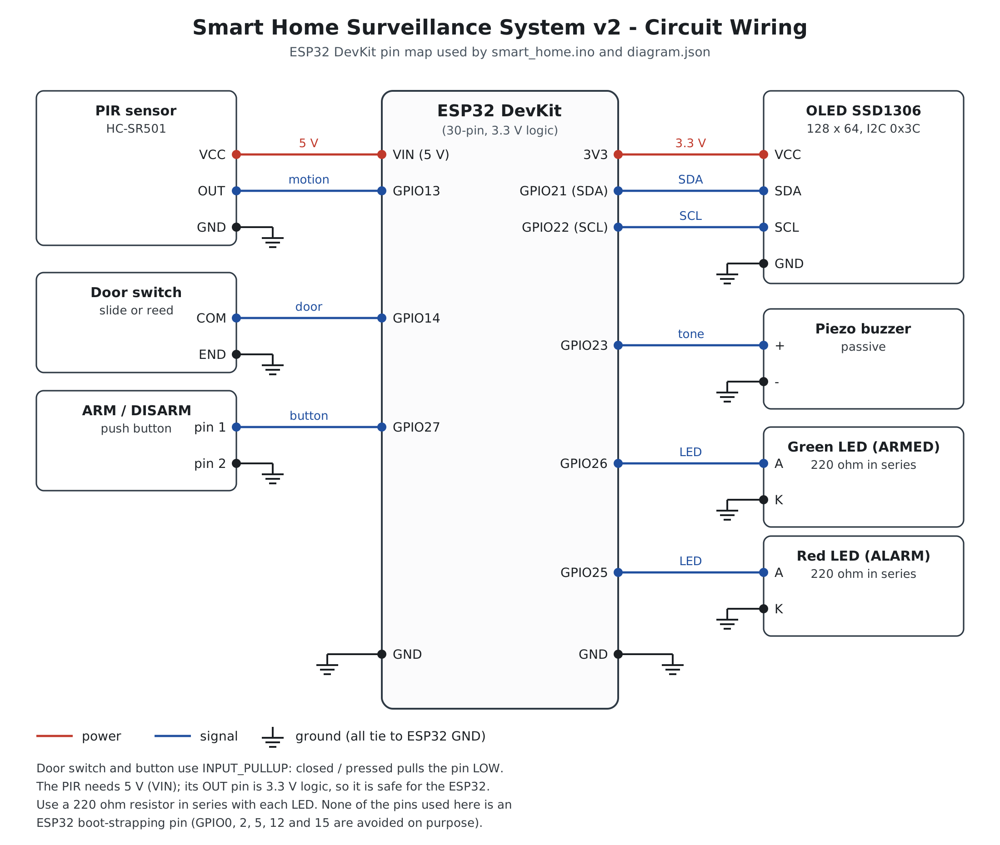

# Smart Home Surveillance System

[](https://github.com/mdhumayun7/Smart-Home-Automation/actions/workflows/ci.yml)


[](LICENSE)

ESP32 intrusion alarm firmware with a PIR motion sensor, a door contact, a local siren and status display, MQTT alerts and Home Assistant integration.

Its main design rule is that the alarm never depends on the network. The detection logic and the siren run on one core and never wait for anything. Wi-Fi, NTP and MQTT run in a separate FreeRTOS task on the other core and exchange data with the alarm logic only through bounded queues.



*Software-in-the-loop run of the firmware: logic analyser view of the GPIO lines, live source trace, the display and MQTT traffic. [Full 2-minute video](docs/media/smart_home_demo.mp4).*

---

## Contents

- [Features](#features)
- [Architecture](#architecture)
- [Hardware](#hardware)
- [Getting started](#getting-started)
- [Configuration](#configuration)
- [MQTT interface](#mqtt-interface)
- [Home Assistant](#home-assistant)
- [Reliability and safety](#reliability-and-safety)
- [Testing and CI](#testing-and-ci)
- [Project structure](#project-structure)
- [Roadmap](#roadmap)

## Features

**Alarm logic**
- Five-state machine: `DISARMED`, `EXIT_DELAY` (10 s), `ARMED`, `ENTRY_DELAY` (10 s), `ALARM` (30 s, then re-arms)
- PIR filtering: warm-up period, 150 ms confirmation and rising-edge trigger, so one person standing still does not retrigger the alarm
- Door contact and ARM/DISARM button with 40 ms debouncing
- Buzzer (2.7 kHz tone), two status LEDs and an SSD1306 OLED status screen

**Reliability**
- No blocking calls in the safety loop; all timing is wrap-safe across the 49.7-day `millis()` overflow
- Armed state stored in NVS and restored after a power cut, so cutting the supply does not disarm the house
- Task watchdog on the safety loop; the boot event reports the reset reason
- Offline event queue (16 events) delivered in order after reconnecting; losses are counted, never silent

**Connectivity and security**
- MQTT with Last Will, retained state, 30 s heartbeat and one JSON message per event with a sequence number
- Remote `ARM` and `STATUS`; remote `DISARM` is refused unless TLS and a broker login are configured (enforced at compile time)
- Credentials in a git-ignored `secrets.h`; optional TLS on port 8883
- Home Assistant MQTT discovery as an alarm control panel

## Architecture



| Core | Task | Responsibility |
|---|---|---|
| 1 | Arduino `loop` (safety loop) | Input conditioning, state machine, buzzer, LEDs, display. Never calls the network. |
| 0 | `net` task | Wi-Fi with retry, NTP, MQTT connection, event delivery, heartbeat, Home Assistant discovery. |

The two tasks share two FreeRTOS queues (events from core 1 to core 0, commands from core 0 to core 1) and one status snapshot that is protected by a mutex. The safety loop never waits on the mutex; it skips a snapshot rather than block.

<details>
<summary>State machine</summary>



If the door is still open when the exit delay ends, the entry delay starts immediately. Only the local button can disarm the system by default.
</details>

<details>
<summary>Event delivery and command flow</summary>



The network task removes an event from the queue before publishing it. If the link drops during the publish, the event goes back to the front of the queue, so the order is kept and nothing is lost silently.
</details>

## Hardware



| GPIO | Part | Notes |
|---|---|---|
| 13 | HC-SR501 PIR, OUT | Powered from VIN (5 V); OUT is 3.3 V logic |
| 14 | Door contact (reed or slide switch) | `INPUT_PULLUP`; HIGH = open |
| 27 | ARM/DISARM push button | `INPUT_PULLUP`; LOW = pressed |
| 23 | Piezo buzzer | 2.7 kHz tone from the LEDC peripheral; `BUZZER_ACTIVE 1` for an active buzzer |
| 26 | Green LED (armed) | 220 ohm series resistor |
| 25 | Red LED (alarm) | 220 ohm series resistor |
| 21 / 22 | SSD1306 OLED, SDA / SCL | I2C address 0x3C |

None of the ESP32 strapping pins (GPIO 0, 2, 5, 12, 15) is used.

**Bill of materials:** ESP32 DevKit v1, HC-SR501 PIR module, reed switch, tactile push button, passive piezo buzzer, green and red 5 mm LEDs with two 220 ohm resistors, 0.96" SSD1306 OLED (I2C).

**Build size** (from CI, `esp32:esp32:esp32`):

| arduino-esp32 | Flash | RAM (globals) |
|---|---|---|
| 2.0.17 | 790,649 B (60.3 % of 1,310,720) | 46,204 B (14.1 % of 327,680) |
| 3.3.12 | 965,281 B (73.6 % of 1,310,720) | 49,708 B (15.2 % of 327,680) |

## Getting started

### In the Wokwi simulator

1. Create an ESP32 project at [wokwi.com](https://wokwi.com).
2. Copy `firmware/smart_home/smart_home.ino` into `sketch.ino`, and replace `diagram.json` and `libraries.txt` with the files in `wokwi/`.
3. Start the simulation. Press the ARM button, wait for `ARMED`, then click the PIR sensor or toggle the door switch.

The default build uses the simulator's `Wokwi-GUEST` network and the public HiveMQ broker, so no configuration is needed.

### On an ESP32 board

1. Install the ESP32 board package (arduino-esp32 2.0.17 or 3.x) and the libraries **Adafruit SSD1306**, **Adafruit GFX Library** and **PubSubClient**.
2. Copy `firmware/smart_home/secrets.example.h` to `firmware/smart_home/secrets.h` and fill in your Wi-Fi and broker details.
3. Set `PIR_WARMUP_MS` to `60000` for a physical HC-SR501, which needs about a minute to settle.
4. Select **ESP32 Dev Module** and upload. The Serial Monitor (115200 baud) prints the device id and the MQTT topics.

With `arduino-cli`:

```bash
arduino-cli compile --fqbn esp32:esp32:esp32 firmware/smart_home
arduino-cli upload  --fqbn esp32:esp32:esp32 -p /dev/ttyUSB0 firmware/smart_home
```

## Configuration

| Setting | Where | Default |
|---|---|---|
| Wi-Fi SSID, password, channel | `secrets.h` | `Wokwi-GUEST`, open, channel 6 |
| Broker host, port, user, password | `secrets.h` | `broker.hivemq.com:1883`, no login |
| TLS and CA certificate | `secrets.h` (`MQTT_USE_TLS`, `SECRET_MQTT_CA_CERT`) | Off |
| Remote DISARM | `secrets.h` (`ALLOW_REMOTE_DISARM`) | Off; requires TLS and login |
| Exit / entry delay, alarm duration | `smart_home.ino` | 10 s / 10 s / 30 s |
| PIR warm-up and confirmation | `smart_home.ino` | 10 s / 150 ms |
| Home Assistant discovery | `HA_DISCOVERY` | On |
| Restore armed state at boot | `RESTORE_ARMED_ON_BOOT` | On |
| Loop watchdog | `ENABLE_LOOP_WDT` | On |

## MQTT interface

All topics are under `svnit/smarthome/<deviceId>/`, where the device id is derived from the chip's MAC address (for example `esp32-A1B2C3D4E5F6`).

| Topic | Direction | Retained | Content |
|---|---|---|---|
| `availability` | device to broker | yes | `online`, or `offline` as the Last Will |
| `state` | device to broker | yes | JSON snapshot on every change and every 30 s |
| `event` | device to broker | no | One JSON message per event |
| `cmd` | broker to device | no | `ARM` (or `ARM_AWAY`), `STATUS`; `DISARM` only if enabled |

```json
{"id":"esp32-A1B2C3D4E5F6","seq":7,"ts":1791786626,"up":26150,"event":"motion","src":"pir"}
```

```json
{"id":"esp32-A1B2C3D4E5F6","fw":"2.1.0","ts":1791786660,"state":"ALARM","ha":"triggered","door":"closed",
 "pir":"idle","rssi":-55,"events":12,"alarms":1,"dropped":0,"queued":0,"up_s":60}
```

Events: `boot` (source = reset reason), `restored_armed`, `exit_delay`, `armed`, `motion`, `door_open`, `door_closed`, `entry_delay`, `alarm`, `alarm_end`, `disarmed`, `cmd_rejected`, `cmd_ignored`.

`ts` is UTC epoch seconds once NTP has synchronised (0 before), `up` is milliseconds since boot, and `seq` increases by one per event since boot, so a client can detect missing or duplicate messages.

Watch the demo device with:

```bash
mosquitto_sub -h broker.hivemq.com -t "svnit/smarthome/#" -v
```

## Home Assistant

With the MQTT integration enabled, the device publishes a retained discovery message to `homeassistant/alarm_control_panel/<deviceId>/config` and appears as an alarm panel named **Smart Home Surveillance**. The firmware states map to Home Assistant states as follows:

| Firmware | Home Assistant |
|---|---|
| `DISARMED` | `disarmed` |
| `EXIT_DELAY` | `arming` |
| `ARMED` | `armed_away` |
| `ENTRY_DELAY` | `pending` |
| `ALARM` | `triggered` |

Arming from Home Assistant works out of the box. Disarming from Home Assistant is rejected unless remote disarm has been enabled with TLS and a broker login.

## Reliability and safety

| Concern | How it is handled |
|---|---|
| Slow or failed network calls | Run only on core 0; the safety loop never waits for them |
| `millis()` overflow after 49.7 days | All timing uses unsigned differences or signed deadline comparisons; tests start the clock just before the wrap |
| Power cut while armed | Armed state in NVS, written once per arm and once per disarm |
| Firmware hang | Task watchdog on the loop task; reset reason reported at boot |
| Network outage | 16-event queue, delivered in order; overflow drops the oldest and counts it |
| Faulty display | Initialisation failure is logged and the alarm keeps running |
| Sensor noise | Debouncing, PIR warm-up, confirmation time and edge detection |

See [SECURITY.md](SECURITY.md) for the threat model and the known gaps.

## Testing and CI

```bash
./tests/host/run_tests.sh
```

The firmware source is compiled unchanged on a PC against stub implementations of the Arduino, FreeRTOS, Wi-Fi, MQTT, NVS and display interfaces, with `-Wall -Wextra -Werror`. Fourteen scenarios are each run at three starting values of the millisecond clock (0, 2^31 and just before the 32-bit wrap) and against the arduino-esp32 2.x and 3.x interfaces: 84 runs in total, plus a build check of the TLS configuration. Every MQTT payload is parsed as JSON.

| Area | Scenarios |
|---|---|
| State machine | `basic`, `arm_alarm`, `disarm_in_entry`, `door_left_open` |
| Input filtering | `pir_edge`, `pir_glitch` |
| Commands | `remote` |
| Fault tolerance | `display_fail`, `persist`, `restore`, `restore_door`, `diag` |
| Display | `oled` |
| Networking | `network` (retry timing, Last Will, retained state, discovery, ordering, failed publish, queue race, overflow, heartbeat) |

GitHub Actions runs the host tests and compiles the firmware for the ESP32 with arduino-esp32 2.0.17 and 3.3.12, reporting flash and RAM usage on every push.

What the tests do not cover: electrical behaviour, real Wi-Fi and broker timing, and true parallel execution on the two cores. These need the Wokwi simulator or real hardware.

## Project structure

```
firmware/smart_home/
  smart_home.ino          firmware
  secrets.example.h       template for credentials (copy to secrets.h)
wokwi/                    Wokwi circuit (diagram.json) and library list
tests/host/               host test harness, stubs and run_tests.sh
docs/images/              architecture, wiring, state machine and sequence diagrams (SVG and PNG)
docs/media/               demo video and GIF
.github/workflows/ci.yml  host tests and ESP32 builds
```

## Roadmap

- Signed over-the-air updates, secure boot and flash encryption
- Tamper switch and battery backup with low-battery events
- ESP32-CAM node that captures an image on the `alarm` event
- Automated Wokwi simulation test in CI
- MQTT client with acknowledged delivery (QoS 1) for events

## Author

**MD Humayun**, M.Tech Computer Science and Engineering, SVNIT Surat. [GitHub](https://github.com/mdhumayun7) · [LinkedIn](https://www.linkedin.com/in/md-humayun-82051521a/)

Released under the [MIT License](LICENSE).
